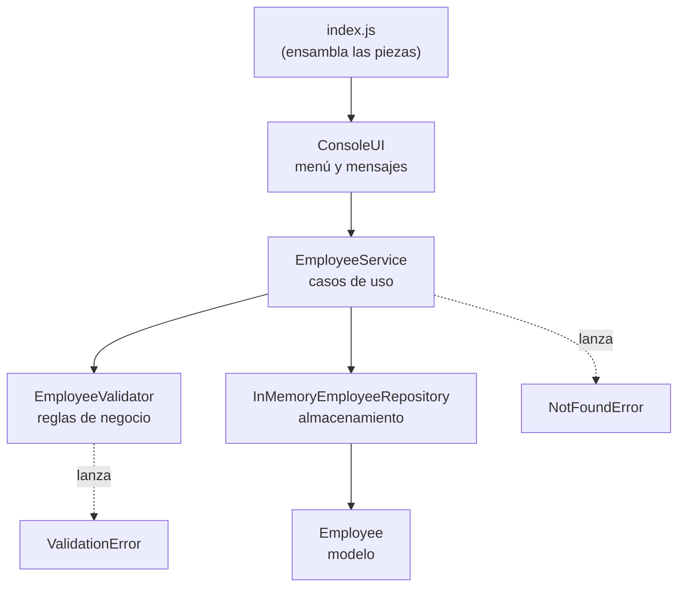

# ACME · Gestión de Empleados

Aplicación de consola en **Node.js** para gestionar la lista de empleados del área de Talento Humano de ACME: registrar, listar, buscar, actualizar y eliminar. Está escrita en **JavaScript moderno (ECMAScript, módulos ES)**, con **Programación Orientada a Objetos** y principios **SOLID**, sin librerías de terceros ni base de datos.

**Autor:** Daniel Borja

---

## Contenido

1. [Instalación](#1-instalación)
2. [Ejecución y uso](#2-ejecución-y-uso)
3. [Requerimientos y reglas de negocio](#3-requerimientos-y-reglas-de-negocio)
4. [Arquitectura](#4-arquitectura)
5. [Conceptos aplicados: POO y SOLID](#5-conceptos-aplicados-poo-y-solid)
6. [Recorrido de los datos](#6-recorrido-de-los-datos)
7. [Decisiones de diseño](#7-decisiones-de-diseño)
8. [Manejo de errores](#8-manejo-de-errores)
9. [Pruebas manuales](#9-pruebas-manuales)
10. [Limitaciones y mejoras](#10-limitaciones-y-mejoras)

---

## 1. Instalación

### Requisitos

| Herramienta | Versión | Para qué |
|---|---|---|
| Node.js | 18 o superior (se recomienda la versión LTS) | Ejecutar la aplicación |
| Git | Cualquiera reciente | Clonar el repositorio |

El proyecto **no tiene dependencias externas**: no hace falta ejecutar `npm install`. Solo usa módulos que vienen incluidos en Node (`node:readline/promises` y `node:process`).

### Linux (sin permisos de administrador, con nvm)

`nvm` es un administrador de versiones de Node que se instala en la carpeta personal, por lo que no requiere `sudo`.

```bash
# 1. Verificar herramientas
curl --version
git --version

# 2. Instalar nvm (si hay una versión más nueva en https://github.com/nvm-sh/nvm, usar esa)
curl -o- https://raw.githubusercontent.com/nvm-sh/nvm/v0.40.3/install.sh | bash

# 3. Cargar nvm en la terminal actual (zsh; en bash usar ~/.bashrc)
source ~/.zshrc

# 4. Instalar la versión LTS de Node
nvm install --lts

# 5. Verificar
node -v
npm -v
```

Si se dispone de `sudo`, `curl` y `git` pueden instalarse con:

```bash
sudo apt update && sudo apt install -y curl git
```

> No se recomienda `sudo apt install nodejs` a secas: en varias distribuciones instala una versión antigua que no ejecuta módulos ES correctamente.

### Windows

En PowerShell:

```powershell
winget install OpenJS.NodeJS.LTS
winget install Git.Git
```

Cerrar y volver a abrir la terminal, y verificar con `node -v`.

### macOS

```bash
brew install node git
```

### Obtener el proyecto

```bash
git clone https://github.com/jdanbo/Prueba_tecnica_Acme_Daniel_Borja.git
cd Prueba_tecnica_Acme_Daniel_Borja
```

### Solución de problemas

| Error | Causa probable | Solución |
|---|---|---|
| `node: command not found` | Node no está instalado o la terminal no se reabrió | Reabrir la terminal; revisar la instalación |
| `nvm: command not found` | nvm no se cargó en la sesión | `source ~/.zshrc` o reabrir la terminal |
| `Cannot use import statement outside a module` | Falta `package.json` o tiene otro nombre | Verificar que exista `package.json` (sin punto al inicio) con `"type": "module"` |
| `Invalid package config` | `package.json` vacío o con JSON inválido | Revisar su contenido con `cat package.json` |

---

## 2. Ejecución y uso

```bash
node index.js
```

o bien:

```bash
npm start
```

Se muestra un menú interactivo. Se elige una opción escribiendo su número y presionando Enter:

| Opción | Acción |
|---|---|
| 1 | Registrar empleado |
| 2 | Listar empleados |
| 3 | Buscar empleado por identificación |
| 4 | Actualizar empleado (por identificador único) |
| 5 | Eliminar empleado (por identificador único, con confirmación) |
| 0 | Salir |

Al **actualizar**, presionar Enter en un campo lo deja sin cambios. Los datos viven en memoria: al cerrar la aplicación se pierden (ver [Limitaciones](#10-limitaciones-y-mejoras)).

---

## 3. Requerimientos y reglas de negocio

### Requerimientos funcionales

| Código | Requerimiento | Implementación |
|---|---|---|
| RF-01 | Registrar empleados con identificación, nombres, apellidos, género, email, teléfono, dirección, ciudad, profesión, cargo, salario e identificador único | `EmployeeService.register()` |
| RF-02 | Listar los empleados | `EmployeeService.list()` |
| RF-03 | Buscar un empleado por su identificación | `EmployeeService.findByIdentificacion()` |
| RF-04 | Actualizar un empleado por su identificador único | `EmployeeService.update()` |
| RF-05 | Eliminar un empleado por su identificador único | `EmployeeService.delete()` |

### Reglas de negocio

Todas se concentran en `EmployeeValidator`:

| Código | Regla |
|---|---|
| RN-01 | Nombres y apellidos no pueden estar vacíos |
| RN-02 | El género debe ser `M`, `F` u `O` |
| RN-03 | Email, teléfono, dirección y ciudad de residencia son obligatorios |
| RN-04 | Profesión y cargo son obligatorios |
| RN-05 | El salario debe ser un número mayor a 0 |

Se añadieron dos validaciones de sentido común: formato básico del email e identificación no duplicada.

---

## 4. Arquitectura

La aplicación se organiza en capas. Cada capa conoce solo a la que tiene justo debajo y tiene una única razón para cambiar.



### Estructura de carpetas

```
index.js                                   Punto de entrada: crea y conecta los objetos
package.json                               "type": "module" (módulos ES)
src/
├── errors/
│   ├── ValidationError.js                 Dato que incumple una regla
│   └── NotFoundError.js                   Empleado inexistente
├── models/
│   └── Employee.js                        Entidad: solo contiene datos
├── validators/
│   └── EmployeeValidator.js               Reglas RN-01 a RN-05
├── repositories/
│   └── InMemoryEmployeeRepository.js      Almacenamiento en un arreglo
├── services/
│   └── EmployeeService.js                 Casos de uso RF-01 a RF-05
└── ui/
    └── ConsoleUI.js                       Menú interactivo
```

### Responsabilidad de cada pieza

| Pieza | Responde a la pregunta | No se encarga de |
|---|---|---|
| `Employee` | ¿Qué datos tiene un empleado? | Validar, guardar o mostrar |
| `EmployeeValidator` | ¿Son correctos estos datos? | Guardarlos o pedirlos al usuario |
| `InMemoryEmployeeRepository` | ¿Dónde viven los datos? | Decidir si son válidos |
| `EmployeeService` | ¿Qué pasos exige cada operación? | Saber cómo se guardan o se muestran |
| `ConsoleUI` | ¿Cómo interactúa el usuario? | Reglas de negocio |
| `index.js` | ¿Quién se conecta con quién? | Cualquier lógica |

**Por qué capas en un programa pequeño:** el enunciado pide POO y SOLID, y separar responsabilidades hace que un cambio toque un solo archivo. Cambiar el menú, una regla de negocio o la forma de almacenar los datos son tres cambios independientes.

---

## 5. Conceptos aplicados: POO y SOLID

### Programación Orientada a Objetos (POO)

Paradigma que organiza el código en **objetos** que combinan datos y comportamiento. Sus cuatro pilares y dónde aparecen aquí:

| Pilar | Definición | En este proyecto |
|---|---|---|
| **Abstracción** | Exponer solo lo necesario y ocultar los detalles | `EmployeeService` usa "un repositorio" sin saber que por dentro es un arreglo |
| **Encapsulamiento** | Proteger el estado interno de un objeto | Campos privados `#employees`, `#nextId`, `#repository`; `findAll()` devuelve una copia |
| **Herencia** | Una clase reutiliza y extiende a otra | `ValidationError` y `NotFoundError` extienden de `Error` |
| **Polimorfismo** | Objetos distintos responden a la misma interfaz | Cualquier repositorio con los mismos métodos puede sustituir al actual |

### Principios SOLID

Cinco principios de diseño orientado a objetos que buscan código fácil de mantener y extender.

**S — Responsabilidad única (*Single Responsibility*)**
*Una clase debe tener una sola razón para cambiar.*
Aquí: `EmployeeValidator` solo valida, `InMemoryEmployeeRepository` solo almacena y `ConsoleUI` solo interactúa con el usuario. Si cambia una regla de negocio, se edita un único archivo.

**O — Abierto/cerrado (*Open/Closed*)**
*Las clases deben estar abiertas a extensión y cerradas a modificación.*
Aquí: para guardar los datos en una base de datos se crea otra clase de repositorio; `EmployeeService` no se modifica.

**L — Sustitución de Liskov (*Liskov Substitution*)**
*Un objeto debe poder reemplazarse por otro de su mismo tipo sin alterar el funcionamiento.*
Aquí: cualquier repositorio que ofrezca `add`, `findAll`, `findById`, `findByIdentificacion`, `update` y `remove` funciona en lugar del actual.

**I — Segregación de interfaces (*Interface Segregation*)**
*Ningún consumidor debe depender de métodos que no usa.*
Aquí: las clases exponen pocos métodos y cada consumidor usa solo los suyos (la interfaz de consola únicamente conoce los cinco casos de uso del servicio). JavaScript no tiene interfaces formales, por lo que se logra con clases pequeñas y enfocadas.

**D — Inversión de dependencias (*Dependency Inversion*)**
*Depender de abstracciones y no de implementaciones concretas.*
Aquí: `EmployeeService` recibe el repositorio y el validador por el constructor en lugar de crearlos:

```javascript
constructor(repository, validator) {
  this.#repository = repository;
  this.#validator = validator;
}
```

Todo el ensamblaje ocurre en `index.js`, el único lugar donde aparece `new`.

---

## 6. Recorrido de los datos

Ejemplo: **registrar un empleado** (RF-01).

| Paso | Qué ocurre | Forma del dato |
|---|---|---|
| 1 | `ConsoleUI` pregunta cada campo con `readline` | Texto suelto |
| 2 | `ConsoleUI` arma un objeto y llama a `service.register(data)` | Objeto plano, todos los valores como texto |
| 3 | `EmployeeService` llama a `validator.validate(data)` | — |
| 4 | El validador aplica RN-01 a RN-05 y devuelve datos limpios | Objeto normalizado: sin espacios sobrantes, género en mayúscula, salario numérico |
| 5 | El servicio verifica que la identificación no exista ya | — |
| 6 | El repositorio asigna el `id` y guarda | Instancia de `Employee` |
| 7 | La respuesta vuelve a `ConsoleUI`, que muestra el mensaje | — |

La idea clave: **el repositorio solo recibe datos que ya pasaron por el validador.** Si la validación falla, el paso 4 lanza un error y los pasos siguientes no ocurren.

Otros recorridos:

- **Listar:** `ConsoleUI` → `service.list()` → `repository.findAll()` → copia del arreglo.
- **Buscar:** `ConsoleUI` → `service.findByIdentificacion()` → empleado o `NotFoundError`.
- **Actualizar:** `ConsoleUI` recoge solo los campos escritos → `service.update(id, changes)` mezcla `{ ...current, ...changes }`, **vuelve a validar todo** y verifica que la identificación no pertenezca a otro empleado.
- **Eliminar:** `ConsoleUI` pide confirmación → `service.delete(id)` → `NotFoundError` si el repositorio no encontró el `id`.

---

## 7. Decisiones de diseño

| Decisión | Razón |
|---|---|
| Dos identificadores: `id` e `identificacion` | `identificacion` es el documento del empleado y se usa para buscar; `id` es el identificador único interno que asigna el sistema y se usa para actualizar y eliminar |
| `id` incremental | Es único, simple y cómodo de escribir en consola |
| El validador devuelve datos limpios | El resto del sistema nunca trabaja con espacios sobrantes, géneros en minúscula o salarios como texto |
| `update` vuelve a validar el objeto completo | Una actualización nunca puede dejar un registro inválido |
| Enter deja el campo sin cambios al actualizar | Evita reescribir los 11 campos para modificar uno |
| Confirmación antes de eliminar | Es una acción destructiva sin posibilidad de deshacer |
| `findAll()` devuelve una copia | Impide que código externo modifique el arreglo interno |
| Objeto `acciones` en lugar de un `switch` | Agregar una opción es agregar una línea |
| Módulos ES y campos privados `#` | Es la forma moderna de ECMAScript y protege el estado de verdad |
| Solo módulos nativos de Node | Cumple la restricción de no usar librerías de terceros |

---

## 8. Manejo de errores

La aplicación nunca se cierra por un dato inválido. Los servicios **lanzan** errores y la interfaz los **atrapa y muestra**, en un único `try/catch` dentro del ciclo del menú.

| Tipo de error | Cuándo ocurre | Qué ve el usuario |
|---|---|---|
| `ValidationError` | Un dato incumple una regla, hay una identificación duplicada o un ID mal escrito | Mensaje claro |
| `NotFoundError` | Se busca, actualiza o elimina un empleado que no existe | Mensaje claro |
| Cualquier otro error | Fallo inesperado | Mensaje genérico; el detalle se registra con `console.error` |

Usar clases de error propias permite distinguir un caso normal del negocio (dato inválido) de un fallo real del programa, sin comparar textos de mensajes. Si se cierra la entrada de la terminal (Ctrl+D o Ctrl+C), la aplicación termina sin errores.

---

## 9. Pruebas manuales

| Caso | Entrada | Resultado esperado |
|---|---|---|
| Registro válido | Todos los datos correctos | `✔ Empleado registrado` |
| RN-01 | Nombres o apellidos vacíos | Mensaje de campo obligatorio |
| RN-02 | Género `X` | `El género debe ser "M", "F" u "O"` |
| RN-03 | Email, teléfono, dirección o ciudad vacíos | Mensaje de campo obligatorio |
| Extra | Email sin `@` | `El email no tiene un formato válido` |
| RN-04 | Profesión o cargo vacíos | Mensaje de campo obligatorio |
| RN-05 | Salario `0`, `-5` o `abc` | `El salario debe ser un número mayor a 0` |
| Duplicado | Identificación ya registrada | `Ya existe un empleado con la identificación...` |
| Búsqueda inexistente | Identificación que no existe | `No existe un empleado con identificación...` |
| Eliminar cancelado | Responder `n` a la confirmación | `Operación cancelada` y el empleado permanece |
| Opción inválida | `9` o texto en el menú | `Opción no válida` y el menú reaparece |

---

## 10. Limitaciones y mejoras

| Limitación actual | Mejora posible |
|---|---|
| Los datos se pierden al cerrar la aplicación (el enunciado excluye la base de datos) | Otro repositorio (archivo JSON o base de datos) sin tocar el servicio |
| No hay pruebas automatizadas | Pruebas unitarias del validador y del servicio con `node:test` |
| El teléfono solo se valida como obligatorio | Validar longitud o patrón por país |
| La búsqueda es solo por identificación | Búsqueda por nombre, cargo o ciudad |
| El listado no tiene paginación ni formato de tabla | Mostrarlo con `console.table` o por páginas |
| Las "interfaces" se respetan por convención | Documentarlas con JSDoc o migrar a TypeScript |
